# Darrow & Rufus: Special Delivery

A 3D browser game I made for my mom, starring our two cats, Darrow and Rufus, and our dog, Penny. Mom's on her way home from work, and the pets have three minutes to stalk mice, chipmunks, birds and squirrels in the backyard and drop them in the living-room basket as "presents" before she walks in. The house and yard are rebuilt from our real ones, and the endings play Mom's own recorded reactions.

**[Play it in your browser](https://csmthy.github.io/special-delivery/)**: keyboard on a computer, touch controls on a phone held sideways.

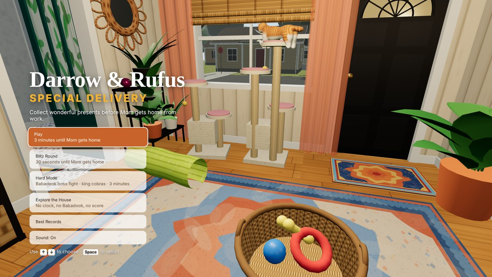

## Pick a pet

Each pet plays differently. Darrow catches easily, but his collar bell gives him away when he runs. Rufus is quiet and fast, but his catches are harder. Penny is a bonus pick: she's hopeless at catching animals but scores easy points with sticks, and she stands her ground against the Babadook. The selected pet stands and wags while the others sit.

| Choosing a pet | Instructions for the chosen pet |
|---|---|
| 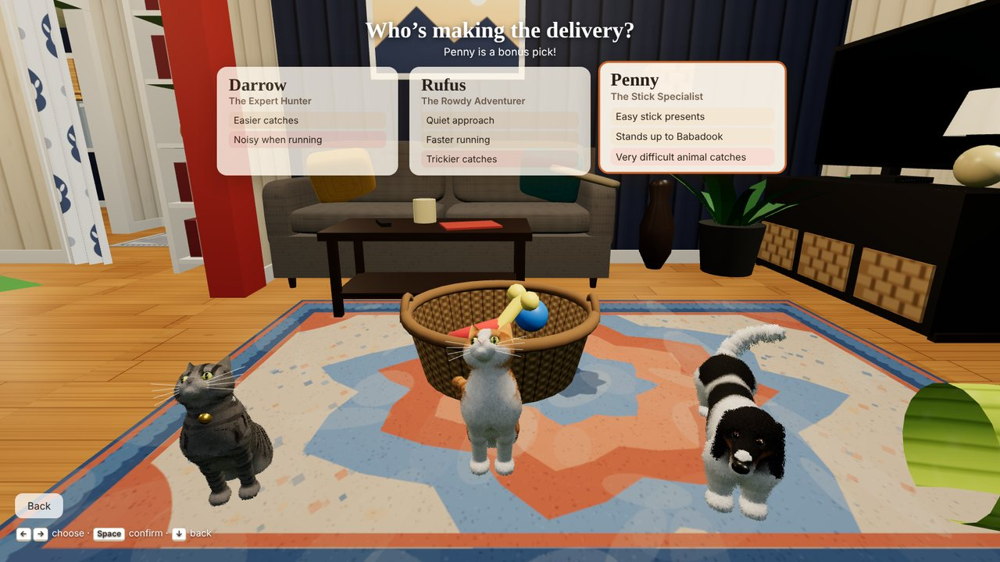 | 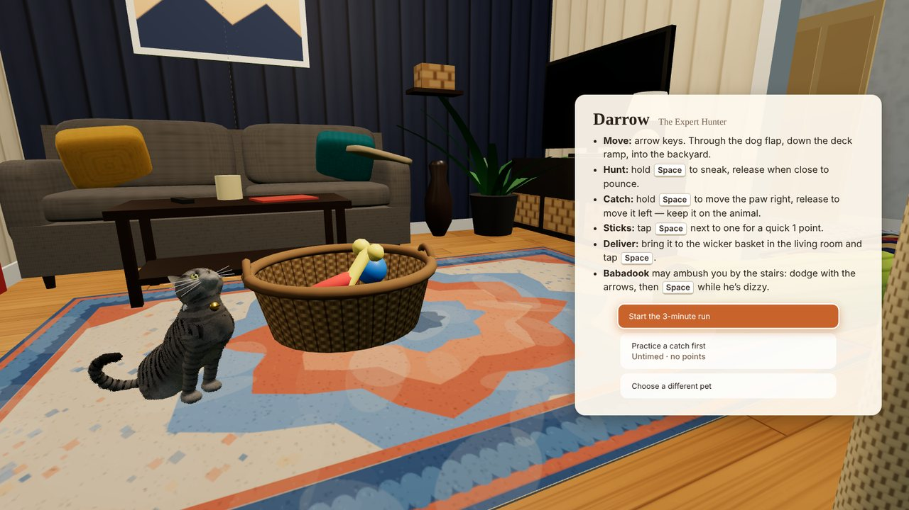 |

## A run, start to finish

1. **Head out** through the dog flap, down the deck ramp and into the yard. The clock in the corner counts down to Mom getting home.
2. **Stalk.** Hold Space to sneak. Animals grow alert the closer and louder you are (running is louder than sneaking, and Darrow's bell louder still) and bolt when they've had enough. Squirrels dash for the nearest tree and climb it. Release Space to pounce when you're close.
3. **Catch.** A pounce that connects starts a short minigame: hold Space to slide the paw right, let go to slide it left, and keep it on the animal as it struggles.
4. **Carry it home** through the yard and up the ramp, and drop it in the wicker basket. Mice, chipmunks, birds, squirrels and sticks are each worth different points, and each present counts once.
5. **Mom gets home.** Her recorded reaction plays for the pet you picked, then the results screen tallies the haul.

| Stalking | The catch minigame |
|---|---|
| 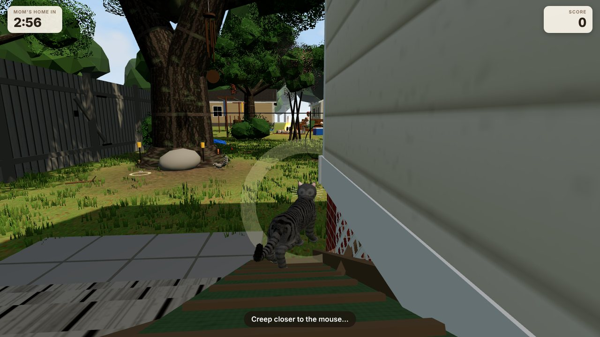 | 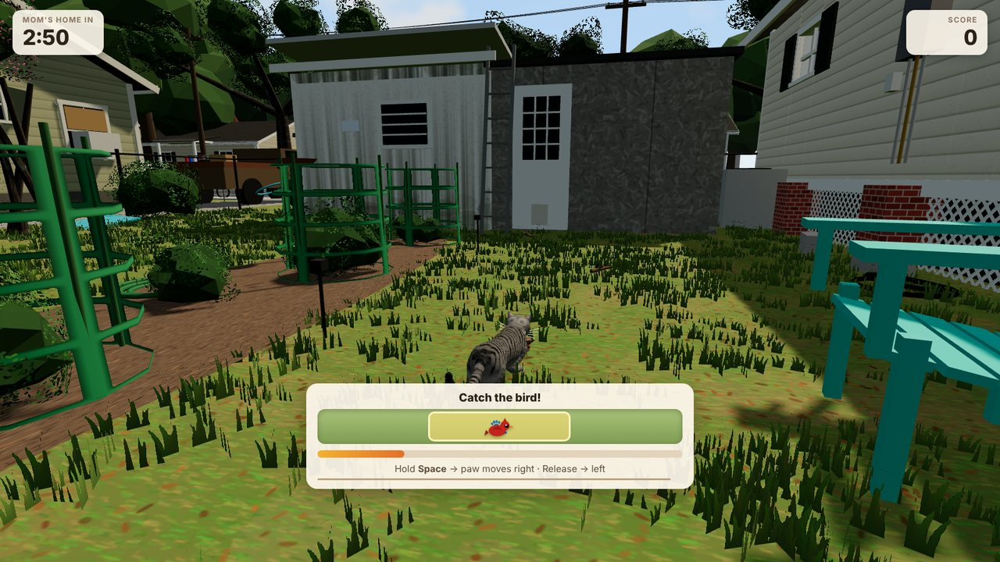 |
| **Bringing it home** | **Delivered indoors** |
| 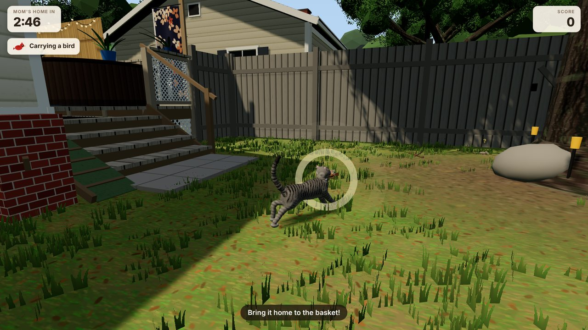 | 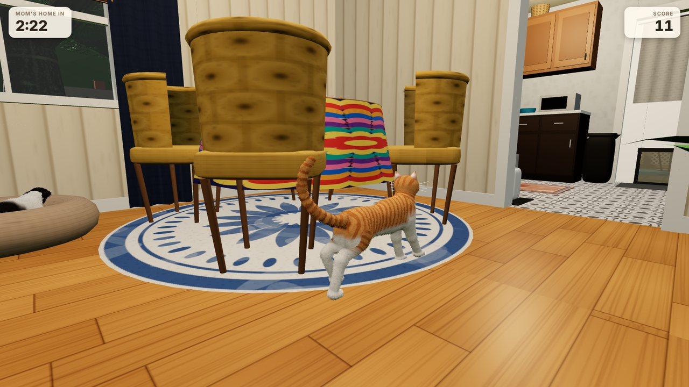 |
| **Mom's home** | **Results** |
| 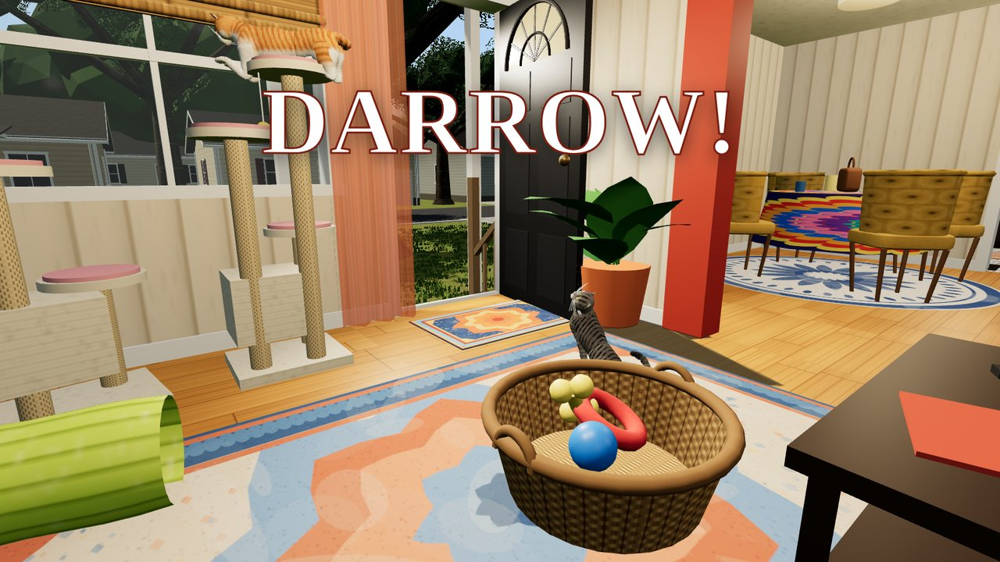 | 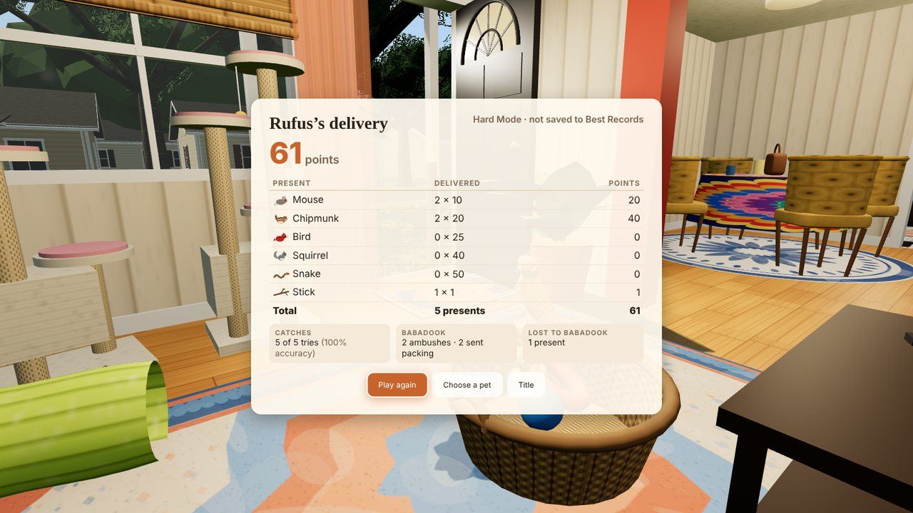 |

## Things that go wrong

- **The Babadook,** a feral tomcat who lives under the house, ambushes you by the stairs. An arrow shows where he's about to lunge, and you dodge with the arrow keys; while he's dizzy afterwards, you can pounce on him. If he gets you, he takes your present.
- **Hard Mode boss fight:** his first ambush becomes a fight with five hit points, a health bar and a paused clock. As his health drops he adds double lunges, rolling shockwaves you have to hop, and fake-out lunges that re-aim at the last second.
- **The mail carrier next door** pops up over the fence at the halfway mark. Every animal on his side of the yard bolts to the other side, and the fear fades slowly over the rest of the run.
- **The back neighbor** gets up from his bonfire and walks over if you hang around his fence.
- **The king cobra** shows up once per Hard Mode run. It's worth 50 points, but deliver it and Mom's reaction is followed by the house going up like a nuke.

| Babadook ambush | The neighbor at the fence |
|---|---|
| 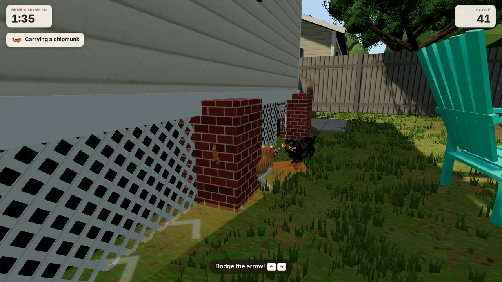 | 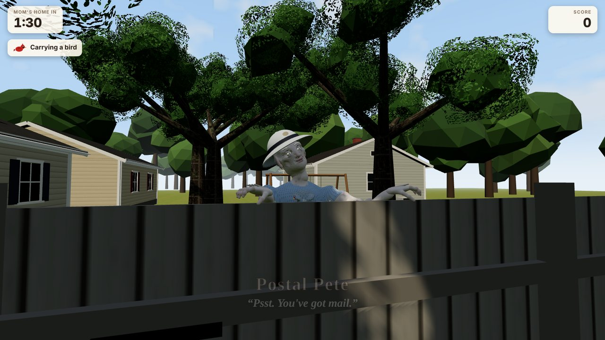 |

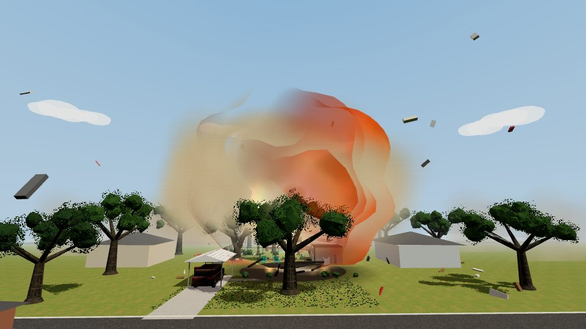

## Modes

- **Play:** the standard three-minute run. Personal bests are saved in the browser.
- **Blitz Round:** 30 seconds, for a quick go or to hear the ending.
- **Hard Mode:** the Babadook boss fight and the king cobra.
- **Explore the House:** no clock, no Babadook, no score.
- **Practice:** an untimed catch to learn the minigame.

## Built entirely in code

TypeScript, three.js and Vite, with no other runtime dependencies. There are no 3D models, textures or sound files apart from Mom's voice clips: everything you see is generated in code.


- **Procedural characters.** The pets, wildlife and neighbors are sculpted from signed-distance "clay" (blended ellipsoids and capsules), turned into meshes and skinned to rigs. Legs are placed with inverse kinematics, gaits change with speed, and tails and floppy ears are driven by springs. Fur is rendered as layered shells, and coat patterns like Darrow's tabby stripes and Rufus's orange-and-white markings are generated per animal.
- **Wildlife AI.** Each kind of animal has its own alertness and calm-down rates, escape behavior and reaction to scares such as the neighbor popping up.
- **Procedural world.** The house, furniture, deck, yard, fences, shed and surrounding neighborhood are built from code with procedural textures, laid out from a floor plan, with colliders for movement.
- **Game logic kept separate from rendering.** Scoring, the Babadook scheduler and the catch minigame live in pure modules (`src/rules.ts`) with unit tests. All balance numbers are in `src/config.ts`.
- **Audio.** Music and sound effects are synthesized live with the Web Audio API. Mom's lines are short clips trimmed and level-matched from home videos.
- **Automated testing.** A dev mode (`?dev`) adds an autopilot that plays the game through the same virtual inputs a person uses; the screenshots here were captured with it.

## On a phone

The game switches to touch controls on a touchscreen: a floating joystick appears under your thumb, and the paw button works like Space. The menus are laid out to fit a phone held sideways in Safari with its toolbars showing, quality drops automatically if frames run slow, and on iPhones it works around the silent switch muting web audio.

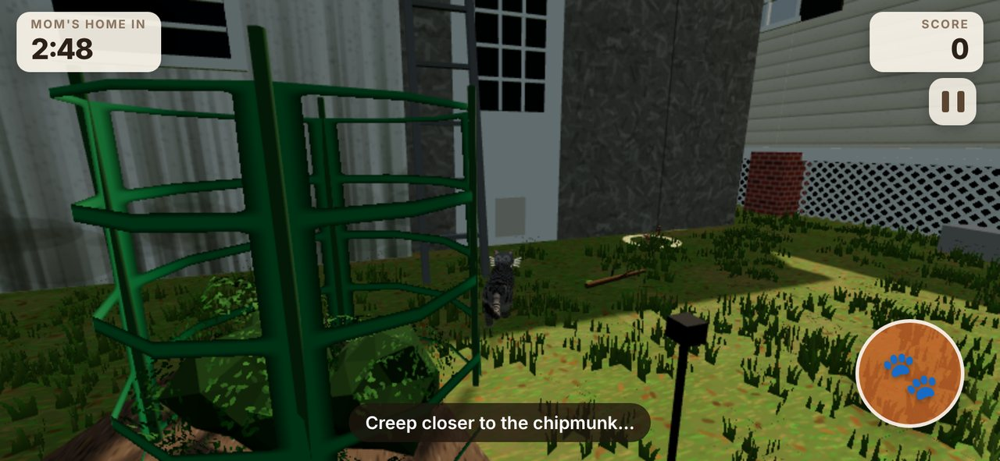

## Run it

```bash
npm install
npm run dev            # http://localhost:5173
npm test               # unit tests (Vitest)
npm run build:single   # writes one self-contained HTML file to dist/
```

`docs/index.html` is that single-file build, served by GitHub Pages. It opens straight from disk too, with no server.

## Layout

```
src/config.ts     balance values: speeds, catch difficulty, points, spawn counts, timings
src/rules.ts      pure game rules
src/game/         state machine, camera, physics, wildlife AI, Babadook, neighbors, snake ending
src/world/        house, furniture, deck, yard, neighborhood, textures, layout and colliders
src/actors/       SDF sculpting, rigs, pets, prey and people
src/ui/           HUD, menus, touch controls, results
src/audio.ts      synthesized audio and recorded lines
src/dev.ts        test-only autopilot and hooks (load with ?dev)
tests/            unit tests
tools/            screenshot harness, model viewer, single-file inliner
```

## License

Code: MIT, see [LICENSE](LICENSE). The voice clips in `src/assets/` are family recordings; please don't reuse them.
