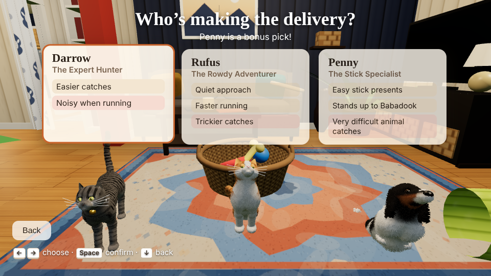
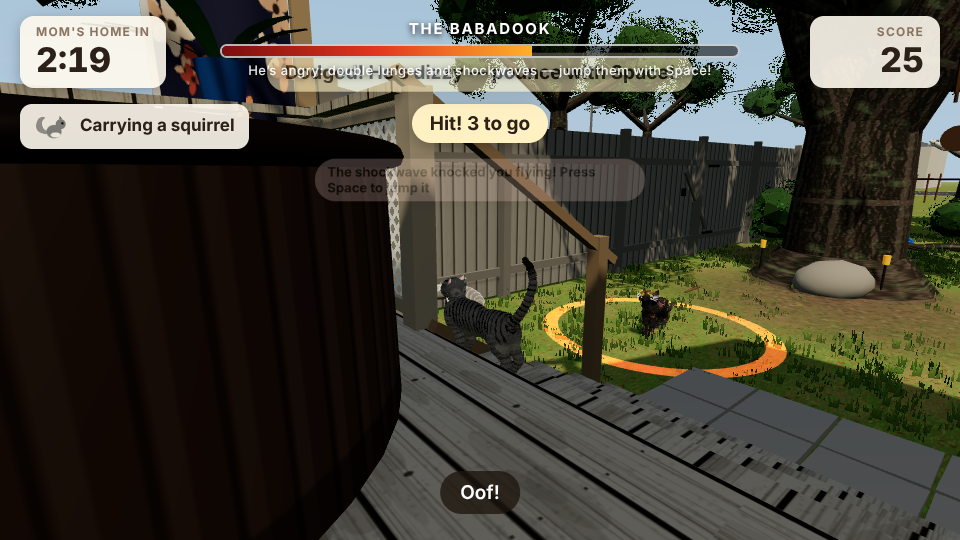
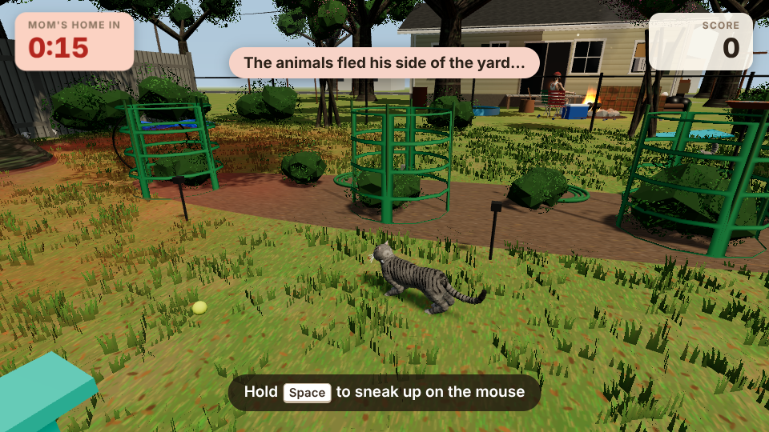
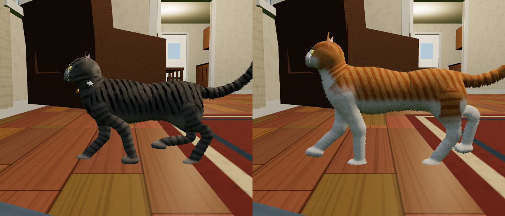

# Darrow & Rufus: Special Delivery

A 3D browser game I made for my mom, starring our two cats, Darrow and Rufus, and our dog, Penny. Mom's on her way home from work, and the pets have three minutes to stalk mice, chipmunks, birds and squirrels in the backyard and drop them in the living-room basket as "presents" before she walks in. The house and yard are rebuilt from our real ones, and the endings play Mom's own recorded reactions.

**[Play it in your browser](https://csmthy.github.io/special-delivery/)**: keyboard on a computer, touch controls on a phone held sideways.



## The game

- **Three pets that play differently.** Darrow catches easily but his bell gives him away when he runs, Rufus is quiet and fast but his catches are harder, and Penny can't hunt well but scores big with sticks.
- **Stalking:** hold Space to sneak, release to pounce, then keep a sliding paw on the animal to finish the catch. Each kind of animal has its own gait and escape behavior.
- **The Babadook,** a feral tomcat who lives under the house, ambushes you and steals your catch. In Hard Mode his first appearance is a boss fight with five hit points, telegraphed lunges, shockwaves to hop and fake-outs.
- **Neighbors:** the mail carrier next door pops over the fence halfway through and scares every animal off his side of the yard, and the back neighbor wanders over if you loiter by his fence.
- **Modes:** normal, a 30-second Blitz, Hard Mode with a king cobra (deliver it and the house goes up like a nuke), Explore, and practice. Personal bests are saved in the browser.

| Hard Mode boss fight | The backyard |
|---|---|
|  |  |

## How it's built

TypeScript, three.js and Vite, with no other runtime dependencies and no art assets: everything you see is generated in code.

- **Procedural characters:** the pets, wildlife and neighbors are sculpted from signed-distance "clay" (blended ellipsoids and capsules), meshed, then skinned to rigs with IK legs, procedural gaits, tails and ears. Coat patterns such as tabby stripes are generated per animal.
- **Procedural world:** the house, furniture, deck, yard, fences and neighborhood are built in code with procedural textures, laid out from a floor plan, with colliders for movement.
- **Game logic** lives in pure modules (`src/rules.ts`: scoring ledger, Babadook scheduler, catch minigame) with unit tests, separate from rendering. All balance numbers are in `src/config.ts`.
- **Audio:** music and sound effects are synthesized live with the Web Audio API; Mom's lines are short clips trimmed and level-matched from home videos.
- **Runs anywhere:** touch controls with a floating joystick, layouts that fit a phone held sideways in Safari, adaptive resolution when frames run slow, and a build step that inlines everything into one HTML file that opens without a server.



## Run it

```bash
npm install
npm run dev            # http://localhost:5173
npm test               # unit tests (Vitest)
npm run build:single   # writes a single self-contained HTML file to dist/
```

`docs/index.html` is that single-file build, served by GitHub Pages.

## Layout

```
src/config.ts     balance values: speeds, catch difficulty, points, spawn counts, timings
src/rules.ts      pure game rules
src/game/         state machine, camera, physics, wildlife AI, Babadook, neighbors, snake ending
src/world/        house, furniture, deck, yard, neighborhood, textures, layout and colliders
src/actors/       SDF sculpting, rigs, pets, prey and people
src/ui/           HUD, menus, touch controls, results
src/audio.ts      synthesized audio and recorded lines
tests/            unit tests
tools/            screenshot harness, model viewer, single-file inliner
```

## License

Code: MIT, see [LICENSE](LICENSE). The voice clips in `src/assets/` are family recordings; please don't reuse them.
